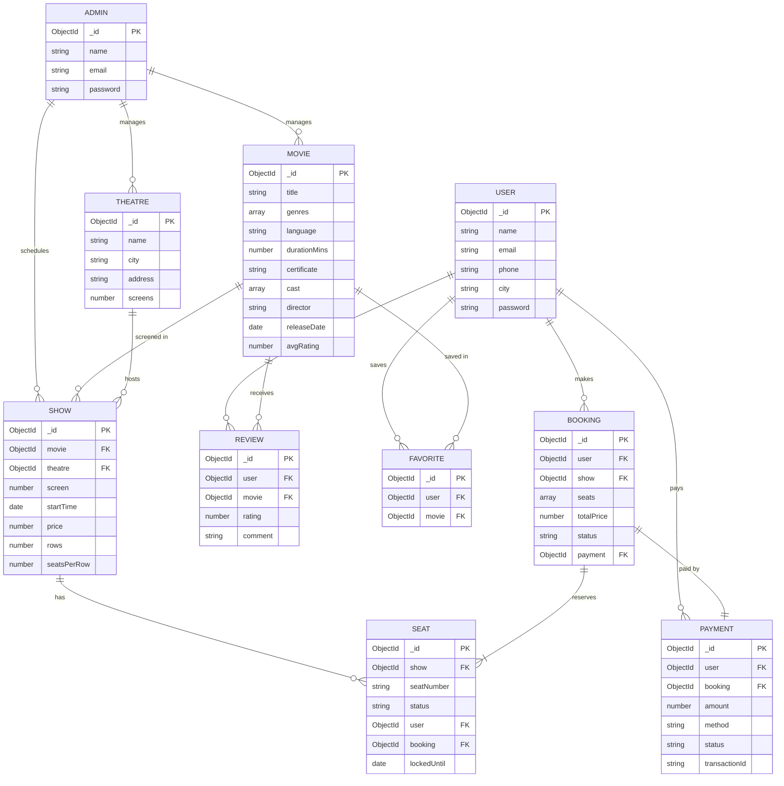

# 🎬 IMovies – Movie ticket booking made simple

IMovies is an online platform for booking cinema tickets. Users can browse movies, pick a theatre and showtime, and reserve seats on a live seat map. Seats are held for a few minutes while the user pays, and other users see those seats change in real time. It is a MERN app: React and Bootstrap on the client, Express.js and MongoDB on the server, with JWT authentication and Socket.io for live updates.

---

## 1. Technical architecture

```
┌────────────────────────────┐        REST (JSON) /api/*         ┌─────────────────────────────┐   Mongoose   ┌───────────┐
│  Client: React + Vite      │ ────────────────────────────────▶ │  Server: Node.js + Express  │ ───────────▶ │  MongoDB  │
│  Bootstrap, React Router,  │ ◀──────────────────────────────── │  MVC: routes → controllers  │ ◀─────────── │           │
│  Axios, Socket.io client   │   JWT in Authorization header     │  → models, JWT, bcrypt      │              └───────────┘
│  localhost:5173            │ ◀═════ Socket.io (seat updates) ══│  Socket.io, Nodemailer      │
└────────────────────────────┘                                   │  localhost:8000             │
                                                                 └─────────────────────────────┘
```

| Layer | What it does | Technology |
| --- | --- | --- |
| Frontend | UI, routing, forms, calls the API, live seat map | React 18, Vite, React Router 6, Bootstrap 5, Axios, socket.io-client |
| Backend | Business logic, security and data access | Node.js, Express 4, JWT, bcryptjs, Mongoose |
| Database | Stores all data | MongoDB |
| Real-time | Pushes seat changes to everyone viewing a show | Socket.io |
| Payments | Simulated gateway that can be swapped for Razorpay or Stripe | `server/utils/paymentGateway.js` |
| Notifications | Booking confirmation and cancellation emails | Nodemailer; emails are printed to the console when SMTP isn't set |

**Backend services (controllers):** Auth, Admin, Movie, Theatre, Show (including seat management), Booking (including payments), Review and Favorite (watchlist).

**Security:**
- **Accounts:**
  - Passwords are hashed with bcrypt and never returned by the API.
  - Login uses JWTs, with role-based access for customers and admins.
  - On a deployment, the admin password must come from the `ADMIN_PASSWORD` environment variable; the public demo password is refused.
- **Abuse protection:**
  - Login and sign-up are limited to 20 attempts per 15 minutes per IP.
  - All API requests are limited to 300 per minute per IP.
  - Request bodies are capped at 20 KB.
- **Injection:**
  - Request data is checked for type and stripped of `$` and `.` keys, so it can never become a MongoDB operator (NoSQL injection).
  - Search text is regex-escaped.
- **Headers:**
  - API responses get Helmet's security headers.
  - The website gets a Content Security Policy and anti-clickjacking headers (see `vercel.json`).
  - CORS only allows the client's origin.
- **Redirects:** after login the app only redirects to its own pages.
- **Secrets and dependencies:**
  - Secrets live only in environment variables or the database, never in the repo.
  - `npm audit` reports no known vulnerabilities in the server packages. The remaining React Router advisories cover server-side rendering and untrusted redirect paths, which this app doesn't use.

## 2. ER diagram



The **Seat** collection only stores seats that are taken. Each document is either `locked` (held during checkout, with a `lockedUntil` expiry) or `booked`. A unique index on `(show, seatNumber)` means two users can never hold the same seat, and a TTL index makes MongoDB delete expired holds automatically.

## 3. Features

- **Registration and authentication:** sign up, log in and log out using JWT. Customers and admins have separate logins.
- **Movie listings:** title, genres, language, duration, certificate, cast, director, release date and average rating. You can search by title and filter by city, genre, language and minimum rating.
- **Theatre and show management:** admins add theatres (with a city and number of screens) and schedule shows. The server rejects shows that would overlap on the same screen.
- **Live seat selection:** an interactive seat map with Available, Selected, Being booked and Booked states, updated instantly over Socket.io.
- **Temporary seat holds:** when you go to checkout, your seats are held for 5 minutes. If payment fails or the timer runs out, the seats are released.
- **Payments:** UPI, card, net banking or wallet through a simulated gateway. Every payment is recorded with a transaction ID. Cancelled bookings are marked refunded.
- **Booking management:** upcoming, past and cancelled tabs, a printable ticket, and cancellation of upcoming bookings.
- **Watchlist:** save movies to look at later.
- **Reviews and ratings:** one review per user per movie, which the user can edit. The movie's average rating updates automatically.
- **Admin dashboard:**
  - Revenue and booking stats, revenue by movie and by theatre, and recent bookings.
  - Manage movies, theatres and shows.
  - View users, bookings and payments, and cancel or refund bookings.
  - Moderate reviews.
- **Notifications:** confirmation and cancellation emails through Nodemailer.

## 4. Roles and responsibilities

| Customer | Admin |
| --- | --- |
| Register and manage their profile | Log in to the admin dashboard |
| Browse, search and filter movies | Add, edit and remove movies |
| Pick a theatre, showtime and seats | Add, edit and remove theatres |
| Pay for tickets | Schedule and delete shows |
| View, print and cancel bookings | Monitor bookings and cancel or refund them |
| Keep a watchlist and write reviews | Track revenue reports and payments |
| | Moderate reviews |

## 5. User flow

**Customer:**
1. Register or log in.
2. Browse movies and open one.
3. Choose a city, date, theatre and showtime.
4. Pick seats on the live map.
5. Click **Proceed to pay**. The seats are held for 5 minutes.
6. Choose a payment method and pay.
7. The booking is confirmed, the ticket is shown and an email is sent.
8. Later, view or cancel the booking and write a review.

**Admin:**
1. Log in at `/admin/login`.
2. Manage movies, theatres and shows.
3. Monitor bookings and payments.
4. Moderate reviews.

**How the data connects:**
- Movie → Show → Seat
- User → Booking → Payment
- User → Review → Movie
- Admin → Movie / Theatre / Show

## 6. MVC pattern

The backend follows Model-View-Controller:
- **Models** (`server/models/`) define Mongoose schemas and indexes.
- **Controllers** (`server/controllers/`) hold the business logic: validation, database operations and building responses.
- **Routes** (`server/routes/`) act as the view layer of a REST API. They map HTTP methods and URLs to controller functions and apply middleware such as `fetchUser` and `adminOnly`.

```
server/
├── app.js                    # Express app: middleware and routes
├── server.js                 # Entry point: starts the HTTP server with Socket.io
├── seed.js                   # Resets the database with sample data
├── config/db.js              # MongoDB connection
├── controllers/              # authController, adminController, movieController, theatreController,
│                             # showController, bookingController, reviewController, favoriteController
├── models/                   # userModel, adminModel, movieModel, theatreModel, showModel, seatModel,
│                             # bookingModel, paymentModel, reviewModel, favoriteModel
├── routes/                   # authRoutes, adminRoutes, movieRoutes, theatreRoutes, showRoutes,
│                             # bookingRoutes, reviewRoutes, favoriteRoutes
├── middlewares/              # fetchUser (JWT auth, roles), errorHandler
└── utils/                    # socket, paymentGateway, notify (email), seats, token, passwordPlugin, asyncHandler

client/
├── vite.config.js            # Dev server and proxy for /api and /socket.io
└── src/
    ├── api/                  # Axios client (attaches the JWT), Socket.io client
    ├── context/AuthContext   # Logged-in user and login/register/logout
    ├── components/           # Navbar, Footer, MovieCard, Stars, ProtectedRoute, Spinner
    └── pages/                # Home, MovieDetails, SeatSelection, Checkout, Ticket, MyBookings,
        └── admin/            # Watchlist, Profile, Login, Register
                              # AdminLayout, Dashboard, AdminMovies, AdminTheatres, AdminShows,
                              # AdminBookings, AdminUsers, AdminReviews
```

## 7. Project setup and configuration

### Requirements
- Node.js v18 or later (tested on v24 LTS)
- MongoDB Community Server running on `mongodb://127.0.0.1:27017`, or a MongoDB Atlas connection string
- Chrome or Firefox, VS Code, and optionally Postman

### Server

```bash
cd server
npm install
cp .env.example .env        # then set JWT_SECRET to a long random string
npm run seed                # sample movies, theatres, shows and accounts
npm run dev                 # http://localhost:8000
```

### Client (in a second terminal)

```bash
cd client
npm install
npm run dev                 # http://localhost:5173
```

### Demo accounts (created by `npm run seed`)

| Role | Email | Password |
| --- | --- | --- |
| Admin (log in at `/admin/login`) | admin@imovies.com | admin123 |
| Customer | user@imovies.com | user123 |

Running `npm run seed` again resets the whole database.

### Environment variables (`server/.env`)

| Variable | Description | Default |
| --- | --- | --- |
| `PORT` | API port | `8000` |
| `MONGO_URI` | MongoDB connection string | `mongodb://127.0.0.1:27017/imovies` |
| `JWT_SECRET` | Secret used to sign tokens | **required** |
| `JWT_EXPIRES_IN` | How long a login lasts | `7d` |
| `CLIENT_ORIGIN` | Origin allowed by CORS and Socket.io | `http://localhost:5173` |
| `SMTP_HOST`, `SMTP_PORT`, `SMTP_USER`, `SMTP_PASS`, `MAIL_FROM` | Optional email settings | Without them, emails are printed to the console |

## 8. API reference

Base URL: `/api`.
- 🔒 means the route needs a customer token.
- 👑 means it needs an admin token.
- 🔓 means it works with or without a token.

Send the token as `Authorization: Bearer <token>`.

| Method | Endpoint | Auth | Description |
| --- | --- | --- | --- |
| POST | `/auth/register` | | Create a customer account → `{ token, user }` |
| POST | `/auth/login` | | Customer login |
| POST | `/auth/logout` | | Log out (the client discards its token) |
| GET / PUT | `/auth/me` | 🔒 | Get or update your profile (name, phone, city) |
| POST | `/admin/login` | | Admin login |
| GET | `/admin/stats` | 👑 | Counts, revenue, revenue by movie and theatre, recent bookings |
| GET | `/admin/users` · `/admin/bookings` · `/admin/payments` | 👑 | Reports |
| PATCH | `/admin/bookings/:id/cancel` | 👑 | Cancel and refund a booking |
| GET | `/movies?search=&genre=&language=&minRating=&city=` | | List movies |
| GET | `/movies/filters` | | Genres, languages and cities for the filter dropdowns |
| GET | `/movies/:id` · `/movies/:id/shows?city=` | | Movie details, and upcoming shows with seats left |
| POST · PUT · DELETE | `/movies` · `/movies/:id` | 👑 | Manage movies |
| GET | `/theatres?city=` | | List theatres |
| POST · PUT · DELETE | `/theatres` · `/theatres/:id` | 👑 | Manage theatres |
| GET | `/shows` | 👑 | Upcoming shows with seats taken |
| GET | `/shows/:id` | | Show details |
| GET | `/shows/:id/seats` | 🔓 | Seat map: `{ booked, locked, mine, lockedUntil }` |
| POST | `/shows/:id/lock` | 🔒 | Hold seats for 5 minutes: `{ seats: ["A1","A2"] }` |
| DELETE | `/shows/:id/lock` | 🔒 | Release your held seats |
| POST · DELETE | `/shows` · `/shows/:id` | 👑 | Schedule or delete a show |
| POST | `/bookings` | 🔒 | Pay for held seats: `{ showId, paymentMethod: "upi" \| "card" \| "netbanking" \| "wallet" }` |
| GET | `/bookings/me` · `/bookings/:id` | 🔒 | Your bookings, or one ticket |
| PATCH | `/bookings/:id/cancel` | 🔒 | Cancel your booking (the payment is marked refunded) |
| GET | `/reviews/movie/:movieId` | | Reviews for a movie |
| POST | `/reviews` | 🔒 | Create or update your review: `{ movieId, rating: 1-5, comment }` |
| DELETE | `/reviews/:id` | 🔒/👑 | Delete your own review, or any review as an admin |
| GET | `/reviews` | 👑 | All reviews, for moderation |
| GET · POST · DELETE | `/favorites` · `/favorites/:movieId` | 🔒 | Watchlist |

**Socket.io events:**
- The client emits `show:join` and `show:leave` with a show ID.
- The server emits `seats:changed` to that show's room whenever a seat is held, released, booked or cancelled.

## 9. How seat holds and real-time updates work

1. **Hold.** `POST /shows/:id/lock` inserts one Seat document per seat with `status: 'locked'` and `lockedUntil` set to now plus 5 minutes. Because of the unique `(show, seatNumber)` index, if another user already holds any of those seats, the insert fails with a duplicate-key error. The server then undoes the part of the hold that succeeded and returns `409`. Two simultaneous requests for the same seat can never both succeed.
2. **Broadcast.** After every change, the server emits `seats:changed` to the show's room, and every open seat map refreshes immediately.
3. **Pay.** `POST /bookings` takes the caller's seats that are still held, marks them `booked`, and runs the payment.
   - If the payment succeeds, the server creates the Payment and Booking and sends the email.
   - If the payment fails, the seats are released.
4. **Expire.** If the user leaves without paying, MongoDB's TTL index deletes the expired holds. Until then, queries already ignore holds whose `lockedUntil` has passed.
5. **Cancel.** Cancelling a booking deletes its Seat documents and marks the payment `refunded`.

## 10. Project execution

1. Start MongoDB.
2. In `server/`, run `npm run seed`, then `npm run dev`.
3. In `client/`, run `npm run dev`.
4. Open http://localhost:5173.
5. To test as a customer, log in as the demo customer and:
   - pick a movie, a showtime and seats
   - pay
   - view the ticket.
6. To see live updates, open the same show in a second browser (or an incognito window) logged in as another user. Seats you hold turn yellow in the other window right away.
7. To test as an admin, log in at `/admin/login` and:
   - add a theatre and a movie
   - schedule a show
   - check the dashboard and reports.

## 11. Deploying to Vercel

The repo is set up to deploy on Vercel as a single project:
- [vercel.json](vercel.json) installs both packages and builds the React client into `client/dist`.
- [api/index.js](api/index.js) runs the Express app as a serverless function for every `/api/*` request.
- All other URLs serve the React app.

Vercel's serverless functions can't hold WebSocket connections, so the Vercel build sets `VITE_REALTIME=polling`. In that mode the seat map refreshes every 4 seconds instead of using Socket.io. Seat holds, payments and double-booking protection work exactly the same. Running locally with `npm run dev` keeps instant Socket.io updates.

When the server starts with an empty database, it loads the sample movies, theatres and accounts by itself. It also keeps the coming week's shows scheduled, so a live demo never runs out of showtimes. You don't need to run the seed script against the live database.

Steps:
1. **Import the project:** on Vercel, go to **Add New → Project** and import this GitHub repo.
   - Set **Application Preset** to **Other**.
   - Environment variables:
     - `ADMIN_PASSWORD`: the admin password for the live site. On a deployment, the public demo password `admin123` never works. Without this variable, the admin gets a random password nobody knows. Changing the variable and redeploying updates the password.
     - `JWT_SECRET` (optional): if you leave it out, the server generates a strong secret once and stores it in the database.
   - Click **Deploy**.
2. **Add a database:** in the project, open **Storage → Create Database → MongoDB Atlas** and connect it to the project.
   - Vercel creates a free cluster and sets `MONGODB_URI` for you. Nobody ever sees or types the password.
   - Alternatively, set `MONGO_URI` to the connection string of your own Atlas cluster.
3. **Redeploy:** go to **Deployments → ⋯ → Redeploy**. The first request fills the database.

Every push to `main` redeploys automatically.
